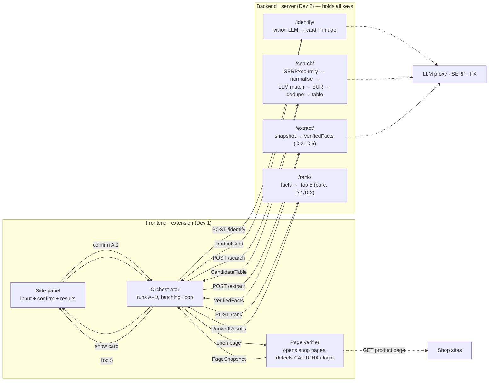

# BestPrice — frontend ⇄ backend workflow

How the browser extension (**frontend**, Dev 1) and the server (**backend**,
Dev 2) communicate across the whole A→B→C→D process.

Boundary rules baked into this flow:

- The **backend holds all API keys** (LLM proxy, SERP, FX). The frontend ships no
  keys.
- The frontend's **Page verifier opens shop pages** (real browser, user locale,
  cookies) — **never Google pages**. The backend never opens shop pages in
  production.
- Page text is **untrusted** (prompt-injection): the backend treats it as data.

## Sequence (messages over time)

```mermaid
sequenceDiagram
    autonumber
    actor U as User
    participant SP as Side Panel · FE
    participant OR as Orchestrator · FE
    participant PV as Page Verifier · FE
    participant BE as Server APIs · BE
    participant EX as LLM proxy / SERP / FX
    participant SH as Shop sites

    Note over SP,BE: Backend holds all API keys; FE never ships keys, never opens Google

    rect rgb(232,244,255)
    Note over U,EX: A. Identify (+ confirmation)
    U->>SP: name / code / photo + size + delivery country
    SP->>OR: query
    OR->>BE: POST /identify { query }
    BE->>EX: vision LLM builds card + SERP representative image
    BE-->>OR: ProductCard (brand, model, colour, code, size system,<br/>search queries/lang, image + ranked image candidates)
    OR-->>SP: show product card
    alt not right
        U->>SP: correct a field / refind image (next candidate)
    end
    U-->>SP: confirm card (A.2)
    end

    rect rgb(232,255,236)
    Note over OR,EX: B. Search (server)
    SP->>OR: confirmed card
    OR->>BE: POST /search { productCard, countries = eurozone }
    BE->>EX: 1 price-sorted SERP call per country (parallel)<br/>+ LLM exact-match + FX → EUR
    BE-->>OR: CandidateTable (matched, deduped, price-ascending)
    end

    rect rgb(255,245,230)
    Note over OR,SH: C + D. Verify & rank — loop until 5 qualify
    loop cheapest batch (~15), 2–3 pages at a time
        OR->>PV: open candidate shop page
        PV->>SH: GET the shop's product page (never Google)
        SH-->>PV: HTML  (or CAPTCHA / login wall)
        PV-->>OR: PageSnapshot (outcome: ok | couldnt_verify)
        OR->>BE: POST /extract { snapshot, productCard }
        BE->>EX: LLM C.2 same? · C.3 size in stock? · C.5 promos;<br/>then C.4 shipping (cached per shop); validate price on page
        BE-->>OR: VerifiedFacts
    end
    Note over OR: qualified ≥ 5 → stop · else next batch (B.5) · table empty → output available
    OR->>BE: POST /rank { facts }
    BE-->>OR: RankedResults (Top 5 by guaranteed total +<br/>couldn't-verify + ships-cost-unknown)
    end

    OR-->>SP: render results
    SP->>U: Top 5 (item + shipping) · possible extra savings · "couldn't verify"
```

## Pipeline overview (who owns what)



## Endpoint ⇄ payload reference

| Step | Call (FE → BE)         | Request body                         | Response            |
| ---- | ---------------------- | ------------------------------------ | ------------------- |
| A    | `POST /identify`       | `Query`                              | `ProductCard`       |
| B    | `POST /search`         | `{ productCard, countries? }`        | `CandidateTable`    |
| C    | `POST /extract`        | `{ snapshot, productCard }`          | `VerifiedFacts`     |
| D    | `POST /rank`           | `{ facts[], tableSize?, top? }`      | `RankedResults`     |

**Note — `POST /verify`.** The backend also exposes `POST /verify { table }`, which
runs the whole C+D loop using a *server-side* HTTP page verifier. That is for
backend-only/standalone testing; in production the **frontend's** Page verifier
opens pages (above), because a server IP gets blocked and lacks the user's
locale/cookies.
